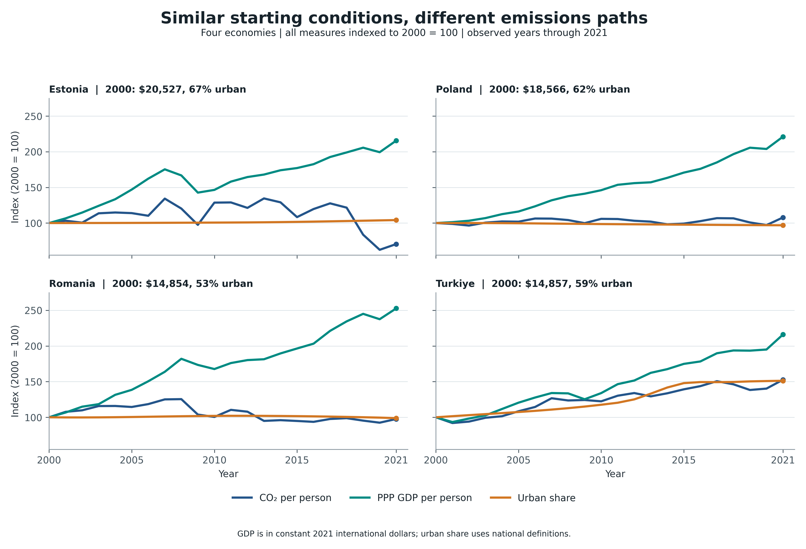
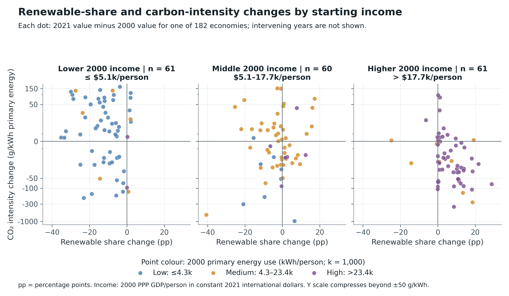

# Economic Development and Carbon Dioxide Emissions

Individual Assignment 2  Exploratory Data Analysis

Yazdan ZandiyeVakili  |  12642780  |  Information Visualization VU  |  TU Wien

I use the merged OWID and World Bank dataset to compare development paths and energy patterns. The charts use observed values only; I did not fill missing data.

## Figure 1  Income urbanization and emissions per person

Research question  RQ2  Over the available years, how did CO₂ per person change alongside income and the share of people living in cities, and which economies followed different paths from similar peers?

Figure 1. Annual paths from 2000 to 2021. For each country and measure, its value in 2000 is set to 100.

Columns used from the dataset: *co2_pc_wdi_t* draws the blue CO₂ line, *gdp_pc_ppp_int2021* the teal income line, and *urban_population_pct* the orange urban-share line. The *year* column sets the x-axis and *country* names the panels. CO₂ per person comes from *co2_mt* and *population_wdi*.

### Design of the visual

I chose two pairs from the WDI Europe and Central Asia region after reviewing the 190 economies with complete endpoint data. In 2000, Estonia and Poland had PPP incomes of about $20,527 and $18,566 per person and urban shares of 67% and 62%; Romania and Türkiye began near $14,855 per person, at 53% and 59% urban. All four have complete annual data through 2021. Their later CO₂ paths differ, so they are useful examples, though not statistical matches or typical cases. Lines show when the paths changed. The vertical axis indexes each measure to its own 2000 value: 100 × annual value ÷ 2000 value. I use 2000 as the common baseline because these series are complete from then and it matches Figure 2's interval. Thus 150 means a 50% rise and 70 a 30% fall. The common scale makes relative changes comparable but hides starting levels.

### What we found

The pairs do not follow one common development path. Estonia and Poland had similar income growth (116% and 121%), yet CO₂ per person fell 30% in Estonia and rose 8% in Poland; their urban shares changed only slightly (+2.8 and −1.9 percentage points). Romania and Türkiye began at almost the same income level, but Romania's CO₂ per person stayed roughly level (−2%) as income rose 153%, while Türkiye's CO₂ per person rose 53% as income rose 116%. Türkiye's urban share also rose far more (+30 points versus about −1 point in Romania). In these examples, income growth or urbanization alone does not describe the emissions path. Other conditions may matter, but this chart cannot identify their effects or show that urbanization caused the difference.

## Figure 2  Renewable energy and carbon intensity

Research question  RQ3  Over years with data for all required measures, how did changes in the renewable share of final energy relate to CO₂ per unit of primary energy, and how did patterns differ by income and energy use per person?

Figure 2. Each dot is one economy. The two axes show its change from 2000 to 2021, rather than its values in each intervening year. The chart includes 182 economies with all four measures in both years.

Columns used from the dataset: *renewable_final_energy_pct* gives the x-axis change (2021 minus 2000, in percentage points), and *carbon_intensity_energy_g_kwh* gives the y-axis change (g CO₂/kWh). The *year* column selects the two endpoints. The 2000 value of *gdp_pc_ppp_int2021* sets the income panel; the 2000 value of *energy_pc_owid_kwh*, primary energy use per person, sets the dot colour.

### Design of the visual

Each dot is one economy, not one year. A dot right of zero had a higher renewable share in 2021; a dot below zero had lower CO₂ intensity. The lower-right quadrant shows both. The income panels split 2000 PPP GDP per person, in constant 2021 international dollars, at $5,076.23 and $17,674.49. Dot colours split 2000 primary energy use per person at 4,295.50 and 23,377.16 kWh: blue is low, orange middle, and purple high. Here, 'high energy use' means more than 23,377.16 kWh per person. These are thirds of this sample, not universal or official categories. The vertical scale compresses changes beyond ±50 g/kWh to keep outliers visible, making distances there harder to judge.

### What we found

In the lower-right quadrant, rising renewable share coincided with falling CO₂ intensity for 1 of 61 lower-income economies, 14 of 60 middle-income economies, and 41 of 61 higher-income economies. Higher income and energy use also overlap: 53 of 61 economies in the highest-income panel have purple dots, so the chart cannot separate their effects. It shows an association between two endpoint changes, not a yearly trend or a causal effect. Renewable share uses final energy and may include biomass; CO₂ intensity uses primary energy. The denominators differ, and the chart does not show what happened between 2000 and 2021.
